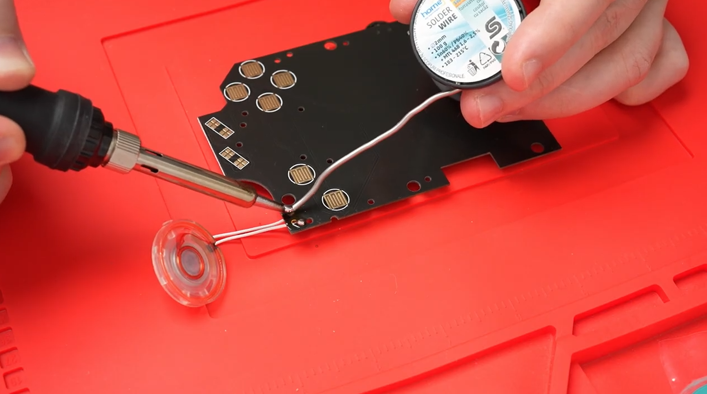

## Starting condition

The grey shell had turned an uneven yellow, with a lighter patch below the logo where something had covered it from the sun. The screen was the usual green-on-green, hard to read, with a dark blotch in the lower left. The A and B buttons had faded to pink. The battery compartment was rusty and the console didn't turn on, which could have been any number of things.

I didn't want to just restore it, I wanted to upgrade it.

## The plan

I've seen videos of people fixing yellowed plastic with peroxide and UV lights, but buying that setup for one console didn't make sense. So I replaced almost everything instead:

- an IPS screen: backlit, sharp, and readable without a lamp next to you
- a shell that's already cut for that screen, so I didn't have to trim any plastic
- new battery contacts, buttons and screws


It's one of my favorite colors and it was in stock at ZedLabz. It also matches this blog's background.


## Steps



## The soldering part

Less than I expected. The Retro Pixel kit comes with its own front board, so there's nothing to desolder from the old screen. The only joints are the speaker's two wires, which move from the original board to the new one. Polarity doesn't matter, so it's a good first soldering job.

## How it plays now

The screen is bright enough to play in bed with the lights off, and I like how the white buttons and lens look on the mint shell. The first cartridge I tried was Pokémon Trading Card Game, which fits, since I'll be writing about card games in Play too.

## What I'd do differently

Near the end I got too excited and rushed to see the result. Even though I'd taken pictures at every step, I put one of the longer screws in the wrong hole, and it pushed through the front a little (that's the small white dot above Start/Select). I was a bit sad, but the console works fine. Maybe I'll cover it with a cute sticker that goes with the shell, IDK. Next time I'll sort the screws by length before closing it up.
